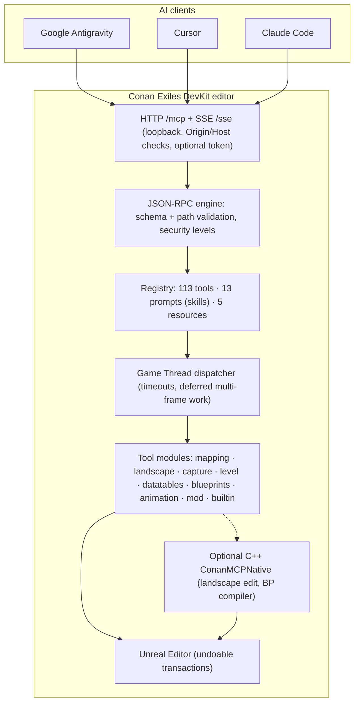

# ⚔️ ConanMCP: Model Context Protocol (MCP) Server for Conan Exiles Enhanced DevKit

<div align="center">

[](https://www.unrealengine.com/)
[](https://www.conanexiles.com/)
[](https://modelcontextprotocol.io/)
[](https://github.com/eneko3d-code)
[](https://deepmind.google/)
[](#-testing--verification)
[](LICENSE)

<br>

**The ultimate bridge connecting modern AI Agents (Google Antigravity, Cursor, Claude Code) directly to the Conan Exiles Enhanced DevKit editor.**

[Installation](#-step-by-step-installation) • [Tools (113)](#-what-it-can-do-113-tools) • [Skills](#-skills) • [Native module](#-optional-native-module) • [Client Setup](#-mcp-client-configuration) • [EULA & Legal](#-funcom-modding-eula-compliance)

</div>

---

## 👤 Author & Credits

- **Creator & Developer:** **Eneko3D** ([@eneko3d-code](https://github.com/eneko3d-code))
- **Architected & Built with:** **Google Antigravity**
- **Compatibility:** built for the **Conan Exiles Enhanced DevKit** (`5.8.2-377096+++exiles+release`). The v1 tools were tested in the DevKit; the 2.0 tools are covered by the automated tests and need live validation (run `get_server_capabilities` first).

---

## 📖 Overview

**ConanMCP** is an Unreal Engine plugin for the **Conan Exiles Enhanced DevKit**. It runs a **Model Context Protocol (MCP)** server
inside the editor (pure Python, nothing to compile) on `http://127.0.0.1:8123` (`/mcp` HTTP and `/sse`).

It lets AI agents (Claude Code, Cursor, Google Antigravity...) **see and edit** the DevKit:

1. **Map design with judgement**: terrain analysis (heights, slopes, walkable %, flat build sites), actor density maps,
   top-down captures returned as images, and a `conan-map-design` skill with real level-design rules.
2. **Terrain editing**: raise / lower / flatten / smooth / noise / ramp brushes and layer painting, either live (optional native
   module) or through a 16-bit heightmap PNG.
3. **Structures and props**: classify everything in the level, query by area, place (single, batch, scatter, along paths),
   snap to ground, duplicate, remove, and validate (floating, buried, overlapping, too steep).
4. **Items, recipes and DataTables**: real row data, schema, search, add/update/duplicate/remove rows, JSON/CSV export and import,
   with base-game tables protected.
5. **Blueprints**: deep inspection, variables, defaults, components, reparenting, compile with errors.
6. **Animation with Control Rig**: give the agent a reference image or description and it poses the character by
   bone roles, compares captures with the reference, builds attack timing, bakes the AnimSequence and makes the montage.
7. **Custom attacks and abilities with particles**: reuse a vanilla attack's damage windows, add Niagara/Cascade bursts,
   trails and sounds at sockets, preview them on the character and hook the montage into the game data.
8. **Mod workflow**: folder layout, broken references, cross-mod dependencies, unsaved packages, rename/move, and a release audit.

Every edit runs on the Game Thread inside an **undoable transaction** (`undo` tool or Ctrl+Z), and every bulk edit supports `dry_run`.

---

## ⚖️ Funcom Modding EULA Compliance

> [!IMPORTANT]
> **This repository strictly complies with Funcom Oslo AS's Conan Exiles Modding Policy and EULA.**
> - **ZERO Proprietary Game Assets Included:** No copyrighted `.uasset` files, 3D meshes, textures, animations, audio, or proprietary game binaries are distributed in this repository.
> - **100% Open & Original Tooling Code:** Contains only original C++ source code, Python automation scripts, documentation, and the `.uplugin` descriptor.
> - Requires a legitimate installation of the **Conan Exiles Enhanced DevKit** via the Epic Games Launcher.

---

## ⚡ Step-by-Step Installation

### Prerequisites
- **Conan Exiles Enhanced DevKit** installed (via Epic Games Launcher).
- Standard plugins enabled in DevKit: `PythonScriptPlugin` and `Niagara` (enabled by default).

### Method 1: Git Clone into Plugins Directory (Recommended)
Open a terminal (PowerShell or CMD) and clone directly into your DevKit's `Plugins` directory:

```bash
cd "C:\Program Files\Epic Games\CEUE5Devkit\UE4\Plugins"
git clone https://github.com/eneko3d-code/Conan-MCP.git ConanMCP
```

### Method 2: Manual Installation (ZIP Download)
1. Download this repository as a ZIP archive from [GitHub](https://github.com/eneko3d-code/Conan-MCP/archive/refs/heads/main.zip).
2. Extract the archive and rename the folder to **`ConanMCP`**.
3. Place it into your DevKit plugins path:
   ```
   [DevKitRoot]\UE4\Plugins\ConanMCP
   ```
   *(Default path: `C:\Program Files\Epic Games\CEUE5Devkit\UE4\Plugins\ConanMCP`)*

### Launching the DevKit
Start the DevKit normally by running:
```bat
RunDevKit.bat
```

Upon editor startup, the startup script (`Content/Python/init_unreal.py`) automatically launches the MCP server in the background at:
```
http://127.0.0.1:8123/mcp
```

### Security configuration (environment variables)
| Variable | Default | Purpose |
|---|---|---|
| `CONAN_MCP_TOKEN` | *(empty)* | If set, every request must send `Authorization: Bearer <token>`. **Recommended.** |
| `CONAN_MCP_READONLY` | `0` | `1` disables all `SAFE_WRITE` tools. |
| `CONAN_MCP_ENABLE_DESTRUCTIVE` | `0` | `1` enables `DESTRUCTIVE` tools such as `execute_python`. |
| `CONAN_MCP_HOST` / `CONAN_MCP_PORT` | `127.0.0.1` / `8123` | Bind address and port. |
| `CONAN_MCP_TIMEOUT` | `30` | Seconds a tool may wait for the Game Thread. |
| `CONAN_MCP_MAX_ACTORS` | `200` | Hard limit of actors per bulk write (spawn, scatter, delete...). |
| `CONAN_MCP_EXTRA_PATHS` | *(empty)* | Extra Python paths (separated by `;`) to add at startup. |

Requests carrying a non-loopback `Origin` or `Host` header are rejected (protects against malicious web pages and DNS rebinding), and package paths must live under `/Game`, `/Engine` or `/ConanSandbox`.

### Verify Server Status
Open PowerShell and run:
```powershell
Invoke-RestMethod -Uri "http://127.0.0.1:8123/mcp" -Method Get
```
Expected output:
```json
{
  "service": "ConanMCP",
  "version": "2.1.0",
  "protocol": "MCP / JSON-RPC 2.0 (2024-11-05)",
  "status": "running",
  "registered_tools": 113,
  "registered_resources": 4,
  "registered_prompts": 13,
  "sse_endpoint": "/sse",
  "messages_endpoint": "/messages"
}
```

---

## 🔌 MCP Client Configuration

### 1. Google Antigravity
Add to your agent or workspace MCP configuration:
```json
{
  "mcpServers": {
    "conan-devkit": {
      "url": "http://127.0.0.1:8123/sse"
    }
  }
}
```

### 2. Cursor (`mcp.json` or Settings > MCP)
```json
{
  "mcpServers": {
    "conan-mcp": {
      "url": "http://127.0.0.1:8123/sse"
    }
  }
}
```

### 3. Claude Desktop / Claude Code
```json
{
  "mcpServers": {
    "conan-devkit": {
      "command": "python",
      "args": [
        "C:\\Program Files\\Epic Games\\CEUE5Devkit\\UE4\Plugins\\ConanMCP\\docs\\mcp_stdio_bridge.py"
      ]
    }
  }
}
```

---

## 🛠️ What it can do (113 tools)

Full reference with every argument: **[docs/tools.md](docs/tools.md)** (generated from the code).

| Area | Highlights | Level |
|---|---|---|
| **System** | `get_server_capabilities` (call first), `undo`, `redo`, `get_output_log` | READ / WRITE |
| **Mapping** | `analyze_terrain`, `sample_terrain`, `get_map_layout` | READ |
| **Landscape** | `get_landscape_info`, `sculpt_terrain`, `paint_landscape_layer`, `export_heightmap`, `import_heightmap` | WRITE |
| **Capture** | `capture_map_overview` (top-down image + pixel→world mapping), `capture_viewport` | READ |
| **Level** | `classify_level_actors`, `find_actors_in_area`, `spawn_actor`, `spawn_actors_batch`, `scatter_actors`, `place_actors_along_path`, `duplicate_actors`, `delete_actors`, `snap_actors_to_ground`, `validate_placement`, `set_actor_property`, `select_actors`, `focus_viewport` | READ / WRITE |
| **DataTables** | `get_datatable_row`, `get_datatable_schema`, `search_datatable_rows`, `add/update/duplicate/remove_datatable_row`, `export_datatable`, `import_datatable` | READ / WRITE |
| **Blueprints** | `get_blueprint_info`, `compile_blueprint`, `add_blueprint_variable`, `set_blueprint_default`, `add_blueprint_component`, `reparent_blueprint` | READ / WRITE |
| **Animation** | `get_skeleton_roles`, `create_animation_preview`, `set_pose_keys`, `generate_attack_keys`, `capture_animation_frames`, `bake_animation`, `create_montage`, `copy_animation_notifies`, `add_animation_notify`, `preview_ability`, `get_animation_info`, `find_animations` | READ / WRITE |
| **Mod** | `create_mod_structure`, `validate_assets`, `audit_mod`, `get_asset_referencers`, `list_dirty_packages`, `save_all_dirty`, `rename_asset`, `delete_asset` | READ / WRITE / DESTRUCTIVE |
| **Assets, Actors, Editor, Skeletons, Particles, Conan** | the original v1 tools (asset search, creation, actor info, sockets, VFX preview, Conan catalog searches) | READ / WRITE |
| **Scripting** | `execute_python`, disabled by default | DESTRUCTIVE |

---

## 🧠 Skills

The plugin ships playbooks in [`skills/`](skills) that give the agent a method and real criteria, not just tools:
`conan-map-design`, `conan-landscape-sculpting`, `conan-structures`, `conan-items-recipes`, `conan-blueprint-authoring`,
`conan-animation-from-reference`, `conan-custom-attacks-vfx`, `conan-mod-release` and `conan-mcp-safety`.

- **Every MCP client** gets them as **MCP prompts** automatically (`prompts/list`).
- **Claude Code / Antigravity** can also install them as native skills. See [docs/skills.md](docs/skills.md).

---

## 🎬 Animations and custom attacks

Paste a reference image into your AI client and ask, for example, *"make this overhead slash for the human male, with a fire
trail and an explosion on impact"*. The agent follows the `conan-animation-from-reference` and `conan-custom-attacks-vfx` skills:
it calibrates the rig, poses it with Control Rig, compares captures with your image, generates the timing, then bakes the
animation, builds the montage, copies the vanilla damage windows and adds the particles. Full walkthrough: [docs/animation.md](docs/animation.md).

---

## ⚙️ Optional native module

Everything works without compiling. Enabling the optional C++ module `ConanMCPNative` adds live in-editor sculpting,
layer painting and exact Blueprint compiler messages. See [docs/native_module.md](docs/native_module.md).

---

## 📦 MCP Resources & Prompts

### Resources (`resources/read`)
- `devkit://status`, `devkit://logs/recent`, `devkit://outliner`, `conan://tables`, `conan://asset/{package_path}`

### Prompts (`prompts/get`)
- The 9 skills above, plus `create-conan-item-mod`, `audit-level-performance`, `inspect-character-skeleton` and `debug-niagara-vfx`.

---

## 🏗️ Technical Architecture



---

## 🧪 Testing & Verification

- `python -m pytest tests` runs 88 tests on any machine, no Unreal needed. They cover:
  - the JSON-RPC engine and the security policy;
  - the HTTP and SSE transports;
  - the terrain and brush math, the 16-bit PNG codec, scatter and placement rules;
  - every new tool against a fake editor (`tests/fake_unreal.py`), including the full
    animation pipeline (preview, Control Rig keys, bake, montage, notifies, captures).
- CI (GitHub Actions) runs the tests, `ruff`, and checks that `docs/tools.md` matches the code.
- Live checks inside the DevKit: `get_server_capabilities` reports exactly which engine APIs your build exposes.
  The tools degrade with a clear message when one is missing.

---

## 📄 License

This project is licensed under the **MIT License**. See the [LICENSE](LICENSE) file for details.

---

<div align="center">
Crafted with ❤️ by <b>Eneko3D</b> using <b>Google Antigravity</b> for the Conan Exiles modding community.
</div>
